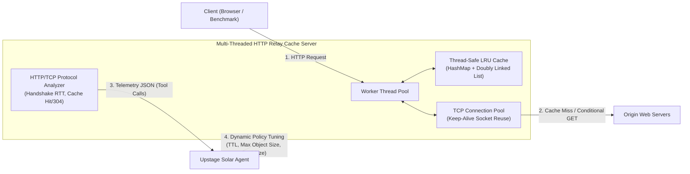

# Building a Relay Cache Server through HTTP Protocol Analysis
> **HTTP 프로토콜 분석을 통한 중계 캐시 서버 만들기**  
> **2026-2 Computer Networks Project (Weeks 9–15)**

## 📌 Project Overview
This project implements a **Multi-Threaded HTTP Relay Cache Server (Web Proxy)** combined with **TCP Connection Pooling (3-Way Handshake Optimization)**, **Thread-Safe LRU Caching**, and an **Upstage Solar LLM Agent** that analyzes real-time HTTP/TCP traffic telemetry to dynamically tune cache policies and connection pools.

### Three Core Requirements (Week 10 Topic Check)
1. **Course Networking Concepts**:
   - **L5 HTTP Protocol & Caching (Weeks 2–3)**: HTTP request/response header parsing (`Cache-Control`, `ETag`, `Last-Modified`, `If-None-Match`, `304 Not Modified` Conditional GET) and Thread-Safe **LRU (Least Recently Used) Cache** implementation.
   - **L4 TCP 3-Way Handshake & Connection Pooling (Week 4)**: Measuring `SYN` → `SYN-ACK` → `ACK` handshake RTT overhead and reusing persistent `Keep-Alive` sockets to origin servers to eliminate redundant handshakes.
2. **LLM Agent Architecture (Week 2)**:
   - Tool-calling agent loop driven by `AGENTS.md` rules, inspecting proxy telemetry (`get_cache_stats`, `get_tcp_handshake_metrics`, `inspect_http_headers`) and autonomously updating proxy parameters (`update_cache_policy`, `adjust_connection_pool`), evaluated with a verification & benchmark suite (`bench.py`).
3. **Model**:
   - Powered by **Upstage Solar API** (`solar-pro` / `solar-mini`).

---

## 🏗️ System Architecture

---

## 👥 Team Roles & Modules

| Module | Directory | Responsibility |
| :--- | :--- | :--- |
| **1. Multi-Threaded Proxy & TCP Pool** | `src/proxy/` | Socket worker threads, HTTP forwarding, TCP 3-Way Handshake RTT measurement & Keep-Alive connection pooling |
| **2. HTTP Protocol Analyzer & LRU Cache** | `src/cache/` | HTTP header parser (`Cache-Control`, `ETag`, `304`), Thread-Safe LRU cache data structure & eviction logic |
| **3. Upstage Solar Agent Controller** | `src/agent/` | Upstage Solar API tool-calling loop, `AGENTS.md` prompt engineering, autonomous cache/pool optimization |
| **4. Benchmark & Dashboard** | `bench/` | Workload generator (`bench.py`), packet/latency measurement, and real-time monitoring dashboard |
